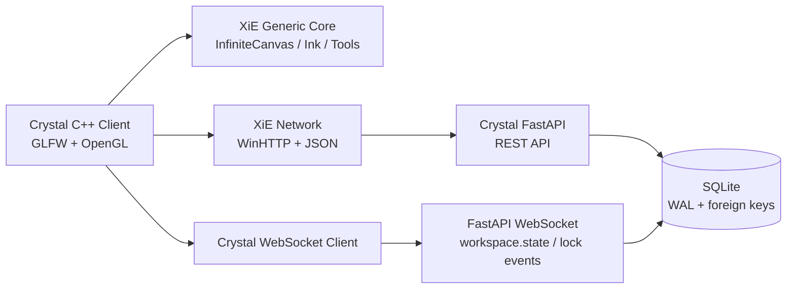

# Crystal 第一阶段 MVP 交付报告

日期：2026-08-10  
范围：XiE 客户端、XiE 通用 2D 能力、Crystal FastAPI/SQLite 服务端

## 1. 交付结论

Crystal Phase 1 已形成可独立构建的 MVP 闭环：客户端可以连接 Crystal 服务端，加载项目与空间，使用无限画布浏览节点，创建/编辑/删除文本节点，切换 Pen/Eraser，保存笔迹与视口，并通过 WebSocket 接收工作区快照和 Scene Lock 事件。

Crystal 被作为独立 CMake 子项目接入，避免被现有 XiE 基线中与本任务无关的未完成合并冲突阻塞。新增客户端目标为 `crystal_client`，核心测试目标为 `crystal_core_tests`。

## 2. 架构



### XiE 通用能力

- `Engine/UI2D/InfiniteCanvas.*`：双精度中心坐标、缩放、屏幕/世界坐标互换、拖拽平移、以鼠标位置为中心缩放。
- `Engine/UI2D/ToolController.*`：Select、Node、Connect、Pen、Eraser 工具路由；中键平移画布；工具捕获与释放。
- `Engine/UI2D/InkStroke.*`：笔迹模型、图层字段、Pen/Eraser 类型、撤销/重做历史。
- `Engine/Network/Json.*`：轻量 JSON 值/解析/序列化。
- `Engine/Network/HttpClient.*`：Windows WinHTTP 的 GET/POST/PUT/PATCH/DELETE 封装。
- `Engine/Network/WebSocketClient.*`：文本消息、连接状态回调、后台线程和基础重连。

### Crystal 客户端

- `Source/Model`：Project、Space、Entity、EntityView、UserLayer、SceneLock 和 Workspace 数据模型及 JSON 映射。
- `Source/Net`：Crystal REST API 客户端和 WebSocket 实时客户端。
- `Source/Workspace`：项目/空间切换、视口保存、节点操作、笔迹加载、锁事件合并。
- `Source/Ink`：本地绘制、结束笔划时提交服务端、擦除、撤销/重做。
- `Source/UI`：简化 HUD、顶部项目/空间信息、工具栏、连接状态、网格、节点、笔迹及 Scene Lock 状态渲染。
- `Source/Main.cpp`：GLFW/OpenGL 主循环，支持鼠标、滚轮、键盘输入；`A` 切换项目，`Tab` 切换空间，`Esc` 退出。

当前内置种子项目为 `P_HighSchool` 和 `XiE`；`P_HighSchool` 含 `Overview` 与 `Architecture` 空间，并包含示例场景节点。

## 3. Crystal 服务端

服务端位置：`XiE_Projects/Crystal/CrystalServer`。

### 数据库

SQLite 默认路径为 `CrystalServer/data/crystal.db`，也可以通过 `CRYSTAL_DB_PATH` 指定。初始化时创建并建立索引的表包括：

- `projects`
- `spaces`
- `entities`
- `entity_views`
- `ink_strokes`
- `scene_locks`
- `user_layers`

数据库连接启用 WAL、外键约束和 busy timeout；种子数据初始化使用幂等插入。

### REST API

已实现：

- `GET /api/v1/health`
- `GET /api/v1/projects`
- `GET /api/v1/projects/{project_id}`
- `GET/POST /api/v1/projects/{project_id}/spaces`
- `GET /api/v1/projects/{project_id}/workspace?space_id=...`
- `PATCH /api/v1/projects/{project_id}/spaces/{space_id}/camera`
- `POST/PATCH/DELETE /api/v1/entities[/{entity_id}]`
- `PUT /api/v1/entity-views/{entity_id}/{space_id}`
- `POST/DELETE /api/v1/ink-strokes[/{stroke_id}]`
- `GET /api/v1/projects/{project_id}/scene-locks`
- `GET /api/v1/scene-locks/{scene_id}`
- `POST /api/v1/scene-locks/{scene_id}/acquire`
- `POST /api/v1/scene-locks/{scene_id}/heartbeat`
- `POST /api/v1/scene-locks/{scene_id}/release`

重复抢锁返回 HTTP 409，并携带当前锁信息；错误释放返回 HTTP 409；不存在的项目、空间、实体和锁返回 HTTP 404。

### WebSocket

连接地址：`/ws/projects/{project_id}`。

连接建立后发送 `workspace.state`，其中包含项目、空间、实体、视图、笔迹、图层和锁状态。服务端支持客户端发送 `scene_lock.heartbeat`，并广播：

- `scene_lock.acquired`
- `scene_lock.released`
- `scene_lock.heartbeat`
- `scene_lock.stale`

客户端在重连后接收完整工作区快照，从而可以恢复当前空间数据。

## 4. Scene Lock 原子性

抢锁在 `SceneLockService.acquire` 中执行：

1. 开启 SQLite `BEGIN IMMEDIATE`。
2. 读取指定 `scene_id` 的锁记录。
3. 只有 `status = 'FREE'` 才执行带条件的更新。
4. 更新 owner、task、branch、heartbeat 等字段后提交事务。
5. 失败事务回滚并返回当前锁信息。

锁对外状态会根据最后心跳时间计算；超过 60 秒视为 stale，但数据库记录仍保留为 `LOCKED`，避免丢失审计信息。

## 5. 验证结果

### 已通过

- CMake 配置：通过。
- `crystal_core_tests` 构建：通过。
- `Crystal core checks=10 status=PASS`：通过。
- CTest：`1/1` 通过。
- Crystal 客户端 `crystal_client` Debug 构建：通过。
- Python `compileall`：通过。
- Scene Lock 服务层测试：3 项通过。
- 100 个并发抢同一 Scene Lock：恰好 1 个成功，其余被拒绝，结果通过。
- `git diff --check`：通过（仅有换行符转换提示）。

### 当前环境限制

本机 Python 环境没有 FastAPI/Starlette/Uvicorn；安装依赖的网络请求超时。因此命令：

```text
F:\Python\python.exe -m pytest -q -p no:cacheprovider -p no:tmpdir tests/test_scene_lock_service.py tests/test_server.py
3 passed, 1 skipped
```

其中 FastAPI HTTP/WebSocket 集成测试整体跳过，不能据此宣称 HTTP 或双客户端 WebSocket 测试通过。补齐依赖后应在 `CrystalServer` 目录运行：

```text
python -m pip install -r requirements.txt
python -m pytest -q
```

两客户端实时同步的端到端实测结果：`待补跑`，原因是上述 FastAPI 依赖未安装；代码路径已实现 `workspace.state` 和 Scene Lock 广播接收。

## 6. 文件变更范围

本次任务新增或修改的主要文件：

- 根构建：`CMakeLists.txt`、`Engine/CMakeLists.txt`、`.gitignore`、本报告。
- XiE 通用 2D：`Engine/UI2D/InfiniteCanvas.*`、`SelectionModel.*`、`ToolController.*`、`InkStroke.*`。
- XiE 网络：`Engine/Network/Json.*`、`HttpClient.*`、`WebSocketClient.*`。
- Crystal 构建：`XiE_Projects/Crystal/CMakeLists.txt`。
- Crystal 客户端：`XiE_Projects/Crystal/Source/{Main.cpp,Graph,Ink,Model,Net,UI,Workspace}` 下的新增文件。
- Crystal 服务端：`XiE_Projects/Crystal/CrystalServer/{app,tests,README.md,requirements.txt,run_server.py}`。
- Crystal 测试：`XiE_Projects/Crystal/Tests/CrystalCoreTests.cpp`。

工作区中原有的音频、UI、Renderer、Core 等未提交变更和冲突文件未被本任务清理或重置；本实现只新增独立 Crystal 目标，并在 `Engine/CMakeLists.txt` 中将新增 Network 模块从旧 `xie_engine` 源文件 glob 中隔离。

## 7. 未完成与下一阶段

- 补齐 Python 依赖后完成 FastAPI TestClient、真实 WebSocket 双客户端同步和启动冒烟测试。
- 将客户端后台 WebSocket 回调改为主线程消息队列，彻底避免渲染线程与网络线程同时访问 Workspace 模型。
- 为 Connect 工具加入实体间关系创建和持久化；当前工具路由已存在，MVP UI 尚未提交关系。
- 增加 Scene Lock 的显式 HUD 操作、心跳定时器和锁失败提示；当前 API、状态模型、广播和渲染指示已具备。
- 增加认证、用户身份、离线 outbox、冲突解决和增量事件版本号。
- 用正式字体、资源系统和主题替换当前内置的最小化 OpenGL HUD。
- 现有 XiE 全量目标仍受任务前已存在的 `Engine/Core`、`Engine/Renderer` 合并冲突及缺失基线文件影响；后续应单独修复基线后再恢复全量构建。

